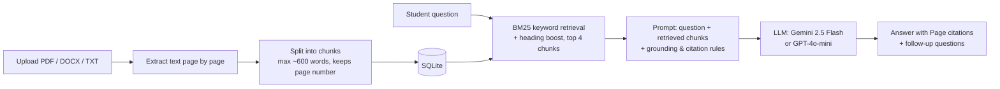

# StudyMate — Your Personal AI Study Assistant 🎓

StudyMate is a full-stack, AI-powered study platform. A student uploads their own study material (PDF, DOCX, TXT) and StudyMate turns it into structured notes, a document-grounded AI tutor with page citations, practice quizzes, spaced-repetition flashcards and a day-by-day study plan.

It is built for **any learner and any subject**: 10th & 12th boards, JEE, NEET, GATE, UPSC / SSC, CA / CS, college end-semester exams, or any skill. Nothing is tied to one course: the AI first works out the subject of the uploaded material and adapts to it.

> **Live demo:** _coming soon_ <!-- add the deployed URL here -->

---

## ✨ Highlights

- **Works instantly, no sign-up needed**: every visitor gets a **private, empty guest workspace**. Signing up later keeps everything they already created.
- **No API key needed by users**: AI is configured once on the server by the site owner.
- **Grounded answers**: the PDF tutor answers only from the uploaded document and cites pages like `[Page 4]`.
- **English, Hindi and Hinglish** output.
- **Works on phones**: responsive layout with a slide-in menu.

---

## 🚀 Features

### 1. Accounts & private workspaces
- Every visitor gets an isolated guest workspace; users never see each other's data.
- **Sign Up** turns the guest workspace into a full account (uploads, notes, chats and quizzes are kept).
- **Log In / Log Out**: data is stored per account on the server, so logging back in restores it; logging out starts a fresh, empty workspace.

### 2. Document upload & management
- Upload **PDF**, **DOCX**, **TXT** or **MD** files (up to 30 MB); text is extracted page by page and split into chunks for retrieval.
- Organise files by any subject or course (free text, with suggestions).
- **Manage Documents**: delete a document, or **replace** it with a new file (the new file is uploaded first, so nothing is lost if the upload fails).

### 3. AI Notes Generator
- Styles: *Detailed Chapter Notes*, *Exam-Oriented Notes*, *Quick Summary*, *Last-Minute Revision Sheet*.
- Depth: short, balanced or in-depth. Levels: *Beginner / School*, *College / University*, *Advanced / Competitive Exam*.
- Options: real-world examples, definitions & key terms, key facts / dates / formulas (whatever suits the subject), practice questions.
- Editable notes with copy, download (Markdown / text) and print.
- AI edits on any text: simplify, shorten, expand, or add examples.

### 4. Ask Your PDF: RAG study tutor
- Retrieval-Augmented Generation: the most relevant chunks are retrieved and only those are sent to the LLM.
- Answers cite page numbers (`[Page 2]`) and suggest follow-up questions.
- **Chat history like ChatGPT**: *New Chat*, auto-titled previous chats, reopen or delete any chat.
- Voice: read answers aloud (text-to-speech) and ask by speaking (speech-to-text, Chrome/Edge).

### 5. Quizzes & "Practice My Mistakes"
- MCQ and True/False questions generated from the document, with explanations and source pages.
- *Practice Mode* (self-paced) and *Timed Test Mode*.
- Real grading and accuracy tracking; **Practice My Mistakes** builds a quiz from questions answered wrong before.

### 6. Spaced-repetition flashcards (SM-2)
- AI-generated decks plus manual cards; flip-card review.
- Review intervals, repetitions, ease factor and due dates computed with the **SuperMemo SM-2** algorithm.

### 7. Personalised study planner
- Schedule generated from exam date, daily hours, confidence level and syllabus topics.
- Day-by-day tasks, completion tracking, custom tasks and rescheduling.

### 8. AI learning tools
- **Concept Explainer**: definition, analogy, step-by-step breakdown, real-world example and a check question, at beginner / intermediate / advanced level.
- **Mind Map**: hierarchical concept tree extracted from a document.
- **Compare & Simplify**: comparison tables for two concepts, or plain-language rewrites of difficult text.
- **Important Exam Questions**: short-answer, long-answer and viva questions with answers.

### 9. Progress & analytics
- Documents, notes, tests taken, average accuracy and study streak.
- **Weak topics** computed from actual wrong quiz answers.

---

## 🧠 How the AI works



- **Chunking**: text is kept per page and split into chunks of at most ~600 words, so every chunk knows its page number. This is what makes page citations possible.
- **Retrieval**: chunks are ranked with **BM25** (term frequency × inverse document frequency, normalised by chunk length), with a boost when the query matches a section heading.
- **Grounding**: the prompt tells the model to answer only from the retrieved excerpts and to cite pages, which reduces hallucinations.
- **Structured output**: quizzes, flashcards, mind maps and study plans are requested as JSON and parsed.
- **Prompt-injection guard**: the uploaded document is treated as data; instructions written inside it are ignored.
- **Subject-neutral prompts**: the model infers the subject (science, commerce, law, history, languages...) and adapts, e.g. formulas for physics, sections/articles for law, dates for history.
- **Reliability**: temporary AI errors (overload, 5xx, per-minute limits, empty replies) are retried automatically with back-off. If the AI is still unavailable, a rule-based fallback builds a basic result from the document text so the app keeps working.

---

## 🛠️ Tech stack

| Layer | Technology |
|---|---|
| Frontend | React 19, TypeScript, Vite, custom CSS design system, `lucide-react` |
| Backend | Node.js, Express 5, TypeScript (run with `tsx`) |
| Database | SQLite via `better-sqlite3` (WAL mode, foreign keys) |
| Documents | `pdf-parse` (PDF), `mammoth` (DOCX) |
| AI | Google Gemini (`@google/genai`), OpenAI (`openai`) as an optional alternative |
| Auth | JWT tokens, `bcryptjs` password hashing |

---

## 📁 Project structure

```
StudyMate/
├── client/                    # React frontend (Vite)
│   └── src/
│       ├── components/        # Sidebar, Header, AuthModal, DocumentManagerModal...
│       ├── context/           # AuthContext (user/guest session), ThemeContext
│       ├── views/             # One file per page: Notes, Chat, Quiz, Planner...
│       └── api/client.ts      # API calls (adds the auth token)
├── server/src/
│   ├── index.ts               # Express app, routes, serves the built frontend
│   ├── config.ts              # JWT secret, storage folders, production checks
│   ├── middleware/            # auth.ts (token check), rateLimit.ts (usage limits)
│   ├── routes/                # auth, documents, notes, chat, quizzes, flashcards, planner, tools, analytics
│   ├── services/              # aiService (LLM calls, prompts, retries), ragService (retrieval), documentService (parsing/chunking)
│   └── db/database.ts         # SQLite schema & migrations
├── data/                      # SQLite database (git-ignored)
└── uploads/                   # Uploaded files (git-ignored)
```

---

## 📦 Run locally

**Prerequisites:** Node.js 20+ and npm.

```bash
# 1. Install dependencies
npm install
npm --prefix client install

# 2. Create your environment file
cp .env.example .env
#    then open .env and set GEMINI_API_KEY (free key: https://aistudio.google.com/app/apikey)

# 3. Start backend + frontend together
npm run dev
```

Open **http://localhost:5173**. The API runs on port 5000 and Vite proxies `/api` to it.

To run the production build locally (one server on port 5000):

```bash
npm run build
npm start
```

---

## ⚙️ Environment variables

All options are documented in [`.env.example`](.env.example).

| Variable | Required | Description |
|---|---|---|
| `GEMINI_API_KEY` | Yes (or `OPENAI_API_KEY`) | Server-side AI key used for all users |
| `AI_PROVIDER` | No | `gemini` (default) or `openai` |
| `GEMINI_MODEL` / `OPENAI_MODEL` | No | Defaults: `gemini-2.5-flash` / `gpt-4o-mini` |
| `JWT_SECRET` | **Yes in production** | Long random string (min 32 chars) used to sign login tokens |
| `NODE_ENV` | No | `production` on the live server |
| `DATA_DIR`, `UPLOADS_DIR` | No | Database and upload folders; point them at a persistent volume when hosting |
| `AI_LIMIT_PER_USER_10MIN`, `AI_LIMIT_PER_IP_10MIN`, `AI_LIMIT_GLOBAL_PER_DAY`, `UPLOAD_LIMIT_PER_USER_HOUR` | No | Usage limits (defaults: 40, 80, 1000, 20) |

Generate a JWT secret with:

```bash
node -e "console.log(require('crypto').randomBytes(48).toString('hex'))"
```

---

## 🌐 Deployment

StudyMate deploys as **one Node.js service**: Express serves both the API and the built React app.

1. Push the repo to GitHub and create a service on a Node host (e.g. Railway or Render).
2. **Build command:** `npm install && npm run build`. **Start command:** `npm start`.
3. Attach a **persistent volume** (e.g. mounted at `/data`) and set `DATA_DIR=/data/db` and `UPLOADS_DIR=/data/uploads`. SQLite and uploads live on disk, so without a volume all data is lost on every restart or redeploy.
4. Set the environment variables: `NODE_ENV=production`, `JWT_SECRET`, `GEMINI_API_KEY` (and optionally `AI_PROVIDER`, `GEMINI_MODEL`). Never upload the `.env` file.
5. Health check endpoint: `GET /api/health`.

---

## 🔒 Security & limits

- Every API request needs a valid JWT; data is always filtered by the logged-in user's ID.
- Passwords are hashed with bcrypt. In production the server refuses to start without a strong `JWT_SECRET`.
- The API key stays on the server and is never sent to the browser.
- **Rate limits** protect the shared AI quota:

| What | Limit |
|---|---|
| AI requests per user | 40 / 10 min |
| AI requests per IP | 80 / 10 min |
| AI requests, whole site | 1000 / day |
| Uploads per user | 20 / hour |
| New guest sessions per IP | 20 / hour |
| Login / sign-up attempts per IP | 20 / 15 min |

- `.env`, the database and uploaded files are git-ignored.

---

## 🧪 Tests & checks

```bash
npm run typecheck        # TypeScript checks for server and client
npm run test:security    # Multi-user isolation tests (start the server first)
npm run test:e2e         # Parse -> retrieve -> AI pipeline test (local dev database)
npm run test:ai-live     # Calls the real AI provider (uses your API key)
```

The security suite checks that one user cannot read, delete or generate content from another user's documents.

---

## 🚧 Known limitations & roadmap

- **Retrieval is keyword-based (BM25).** Questions that use synonyms or a different language from the document can miss the right section. *Planned:* embedding-based semantic search, plus a small evaluation set to measure retrieval accuracy.
- **Scanned / image-only PDFs are not supported** (no OCR yet). *Planned:* extract text from scans and photos of handwritten notes with Gemini's vision input.
- **Single-server design**: SQLite and in-memory rate limits suit one instance. Scaling out would need PostgreSQL and a shared store (e.g. Redis).
- Answers are generated in one piece. *Planned:* streaming responses in the chat.

---

## 🎨 Design

- **Light theme "Warm Ivory"**: background `#FBF9F5`, purple accent `#7C3AED`.
- **Dark theme "Slate Charcoal"**: background `#0B0F17`, purple accent `#8B5CF6`.
- **Fonts**: *Outfit* (headings) and *Inter* (body), from Google Fonts.
